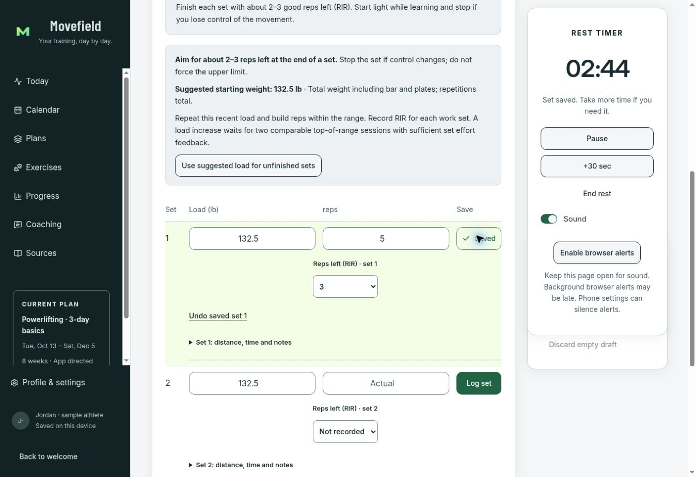
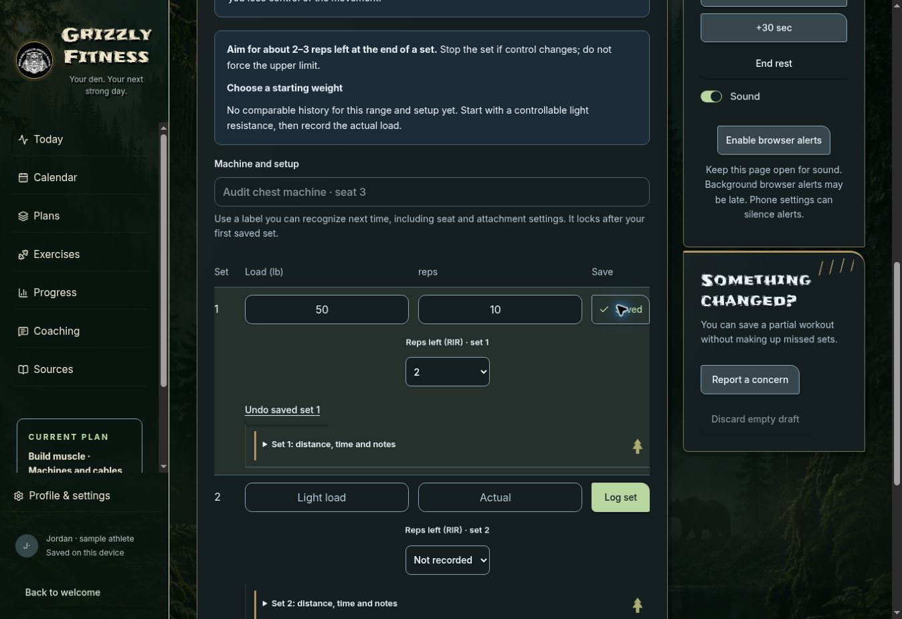

# Movefield and Grizzly app audit — 13 October 2026

Both brands are in scope. The audit began at source `00559e36850233c54adcfaa95ca4f5c13a0aa93d` and Pages `0b373386ec2782484ffcdc46a94ba87971bdf570`. Changes share training logic while preserving separate app identity, records, preferences and caches. OG Grizzly stays retired. The original `/movefield/` installation is preserved; the updated Movefield application is `/movefield/review/`.

## Findings and fixes

| Domain | Confirmed defect or friction | Correction |
| --- | --- | --- |
| Production plan loading | Live sample bodybuilding setup blanked the web app with `undefined.uid`. Source-only tests missed the circular import capture. | Live module imports replace eager namespace snapshots; optimized and minified production regression covers the exact journey. |
| Native plan setup | An undeclared `sourceChoice` crashed setup; two catalog examples did not meet their own prerequisites. | Correct prop contract, explicit demo assumptions, and real preview/lifecycle checks. Personal setup retains its own profile. |
| Training progression | Some rising running stages could advance without comfortable prior feedback; a longer-bout introduction implied an unverified ability. | Uniform prerequisite checks, gradual app-authored stages, and running-specific explanations. Repeated/easier stages remain usable. |
| Evidence presentation | Regional muscle counts could imply individual-muscle precision; six-day public PPL needed recovery context. | Explicit broad-region accounting and contextual workload cautions, preserving creator prescriptions. |
| Web logging | Misaligned columns, incorrect exercise ordinal, blank focused logger after substitution, and dropped machine setup edits. | Dedicated set rows, per-set effort/details, stable local text editing, accurate numbering and safe focus reset. |
| Editing and navigation | Huge saved-session editor, stale editing state, repeated setup steps, obstructive closing effects. | Exercise-level disclosure, state cleanup, validated returning-profile shortcuts, 150ms close transitions. |
| Native interaction/performance | Catalog regeneration on global timer ticks, wrong selected-date event entry, adjacent-month mismatch, reorder edits losing identity. | Memoized catalog inputs, foreground timer scoping, date-aware actions and identity-safe editing. |
| Native reminders | Grizzly notification kind did not match the foreground handler. | Shared brand-aware notification kind with callback regression. |
| Data/platform | Stale or wrong-scope offline status; mismatched Grizzly native callbacks; unbounded failed coaching-job rows. | Exact registration lifecycle, one qualified native scheme per deployment, and job-creation budgets with retry preservation. |

See the separate [training](full-audit-training-2026-10-13.md), [scientific evidence](science/full-audit-evidence-2026-10-13.md), [web](full-audit-web-2026-10-13.md), [mobile](full-audit-mobile-2026-10-13.md), [runtime](full-audit-runtime-2026-10-13.md), and [platform](full-audit-platform-2026-10-13.md) records. The integrated validation/publication receipts pin the delivered source and checks.

## Coverage

- Catalog: 145 original definitions, eight public strength versions and NHS. A full-block lifecycle traverses 154 plans, 4,899 workouts and 31,550 sets, including 1,387 save/reloads. These are synthetic functional tests, not human training outcomes.
- Selection: 6,881 generation scenarios; 7,776 detailed equipment/frequency/time/no-floor scenarios; production bundles each exercise 201 build/accept/reopen cases.
- Native: 148 actual catalog previews across seven starting weekdays and a first-workout lifecycle for each; all 995 exercise guides are checked structurally.
- Science: all nine goal families reviewed with explicit applicability, source depth and limits. The exact app-authored routines have not each undergone a controlled trial. More volume is not automatically scored as better.
- Direct browser baseline: Grizzly sample start, suggested load, per-set RIR, save, rest pause/extension, incomplete finish, partial history, correction review/save, calendar details and plan setup. Movefield independently opens sample data, exercise search, instructions/history, progress chart switching and settings. The bodybuilding failure was observed in the actual published app and reproduced in both production bundle modes. Post-publication checks are recorded separately.

## Limits and remaining work

This is a broad engineering and evidence audit with fixes, not a claim that every possible button/state/device combination is certified. Browser actions used only synthetic sample records. No private profile passphrase, live account connection, real workout record or paid provider was used.

Installed Android/iPhone acceptance, signed APK/IPA delivery, comprehensive rendered accessibility and physical notification/keychain tests remain open. Native dependency scans still report two unpatched upstream tooling advisories across 15 affected entries. Web production dependencies scan clean. Connected accounts/provider operation stays disabled until its existing qualification gates pass. The canonical task register retains unfinished next-block/baseline editing, specialized sport/race capabilities and broader product requirements.

Running logs currently record total duration rather than performance of each jogging interval. Guidance explicitly asks users to repeat a stage if they substituted walking for a prescribed jogging bout; recorded duration alone does not establish objective running readiness.

## Continuing

Use `scripts/verify-core.mjs`, now including production bundling, runtime contracts, complete training lifecycles, actual web/native control callbacks and offline lifecycle checks. Sync canonical `lib/` to native before final builds. Preserve source provenance, unknown loads, per-set RIR, reviewed progression, old compiled assets and the original Pages app. Publish only the existing two preview directories unless an explicit migration is designed and approved.

## Published result and browser verification

The existing Movefield review and Grizzly previews are live. See [the publication receipt](full-app-audit-publication-2026-10-13.json) for pinned source/Pages commits, deployment, live byte checks and post-release sample journeys. Both brands successfully saved a set with its own effort rating. Movefield also saved an explicitly partial workout without counting unfinished sets. The previously crashing Grizzly bodybuilding setup successfully selected, reviewed and started a matching plan. The original Movefield demo remains available.

Live byte verification matched 261 of 265 selected files, including all 63 original-root files; four requests were blocked by the runner's network proxy. Those four bytes are unverified, not reported as matching. Direct browser rendering and sample actions succeeded.

