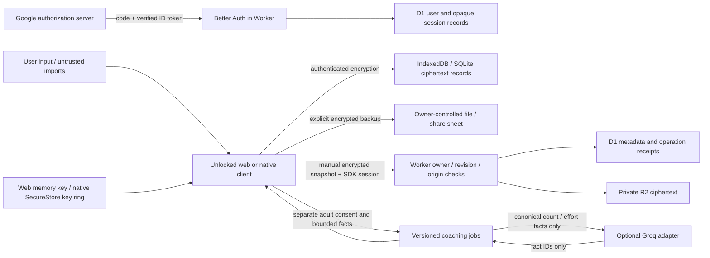

# Current data and trust boundaries

This inventory describes the local candidate, not a deployed architecture. Accounts and cloud storage are disabled by default. The owner has supplied an Account ID; no usable management connection, deployed origin, billing protection or application-secret binding has been verified. Future coach/team roles, wearables, email/password reset, app passkeys/TOTP and downloaded models are absent.

Plaintext training exists in the unlocked client's memory and UI. Native keys reside in SecureStore; browser keys remain in memory. Stored private workout rows and indexes are authenticated ciphertext. Setup drafts and queued uploads are separately encrypted. Sample JSON uses separate namespaces and never establishes account authority. A compromised unlocked origin/device can observe input and decrypted records; encryption at rest does not solve that boundary.

Normal backups are portable encrypted snapshots. Original-file recovery bundles preserve the complete original index and rows; a retained legacy plaintext cache is explicitly identified before export. Reviewed plan/history JSON exports are plaintext. Owners can save or share these files outside the app; erasure cannot recall recipient/downloaded copies. Native temporary exports are scoped app-owned copies, with cleanup and late-export guards, not a forensic wipe guarantee.

D1 user records contain verified Google email and app identifiers. SDK sessions use opaque random tokens, expire and can be revoked; account tables discard Google access/refresh/ID tokens. Session metadata views omit tokens, device names and IPs. This does not mean the service processes no IPs: Cloudflare sees network addresses and the SDK uses the connecting address for rate limiting. Provider/platform retention and operator access still require owner-console review. No telemetry or request logging is intentionally enabled in the supplied Worker examples.

R2 receives ciphertext; D1 holds revision, object pointer, digest, consent and operation metadata. The server does not possess a cloud recovery passphrase. Snapshot uploads write R2 before transactional D1 compare-and-swap/receipt acknowledgement. These services do not share a transaction; interrupted/orphan cleanup is a bounded maintenance operation requiring live qualification. Account tombstones prevent late writes after deletion. Local records, cloud records and exported copies have separate deletion paths.

Optional coaching receives a self-reported bounded workout packet at the account service and derives only count/effort facts for Groq. The provider cannot commit targets or return arbitrary display prose. Model-selected IDs are validated against canonical facts. Adult/eligibility claims are self-reported, not verified age or clinical clearance; youth/privacy/provider qualification remains a release gate. Arbitrary imported titles/notes are not added to the provider packet. No on-device weights or inference runtime are installed.

The production service worker caches only the stateless shell/static assets. Authentication and business responses are private/no-store and never receive the offline-shell opt-in. Private training is not rendered by the server. Introducing private SSR, background sync, a new identity provider or a model download requires revisiting this boundary. Cache hashes and old-window update behavior do not establish mixed-version phone/update qualification.

The asset/control inventory is [security-controls.json](security-controls.json). It uses actual ASVS 5.0.0 and MASVS 2.1.0 identifiers read from the official tagged sources, with source hashes and attribution. Local observations are partial evidence; no row declares complete standards conformance. The MASTG release was identified as 2.0.0; exact platform test mappings and current NIST SSDF/API/GenAI baseline review remain pending. Controls are not marked passed just because an algorithm or SDK is present.

Attacker entry points include anonymous API abuse, stolen sessions, another authenticated owner, stale browser/native panels, same-origin scripts, modified clients, untrusted files/text, corrupted/missing local rows, replayed outboxes, compromised build dependencies and operator mistakes. Server identity always comes from a verified SDK session. The expected-account header is a comparison guard, not authority. A modified client can still misreport training or eligibility; deterministic checks cannot certify physical performance or legal consent.

Installed callbacks, device backup/reinstall, screenshots/app-switcher exposure, keyboard behavior, missing device lock, OS patch suitability, signing/update channels, independent penetration/crypto/privacy review and live resource/retention/spending checks remain explicit acceptance work. Android API 24/iOS 16.4 dependency minima are compatibility declarations, not a claim that every old phone has current security updates.
